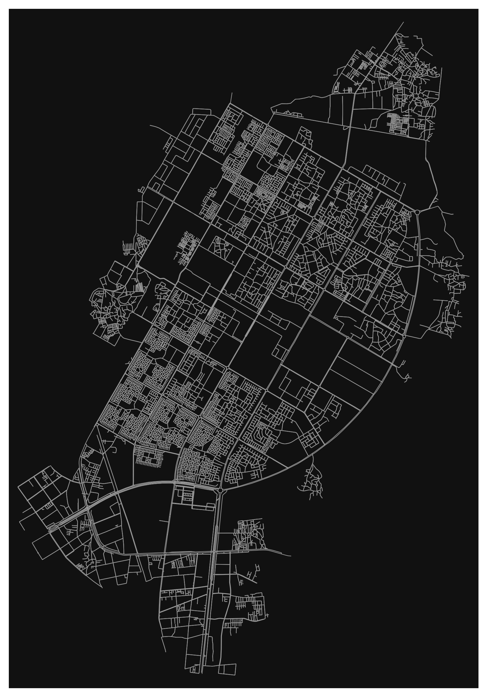
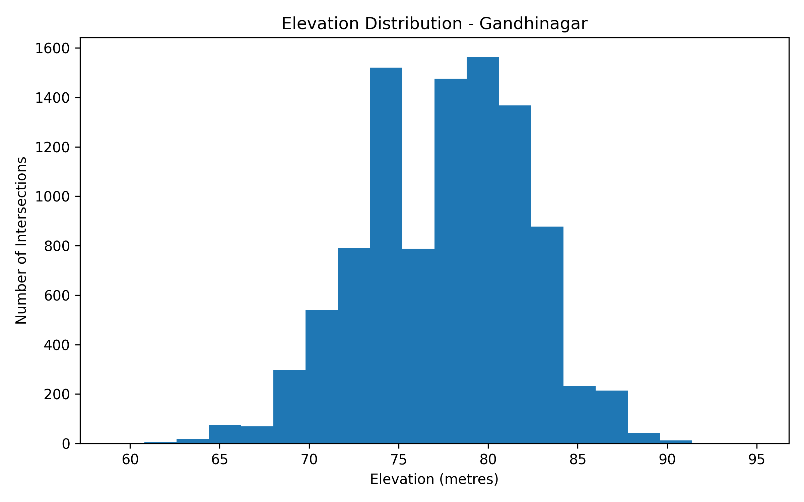
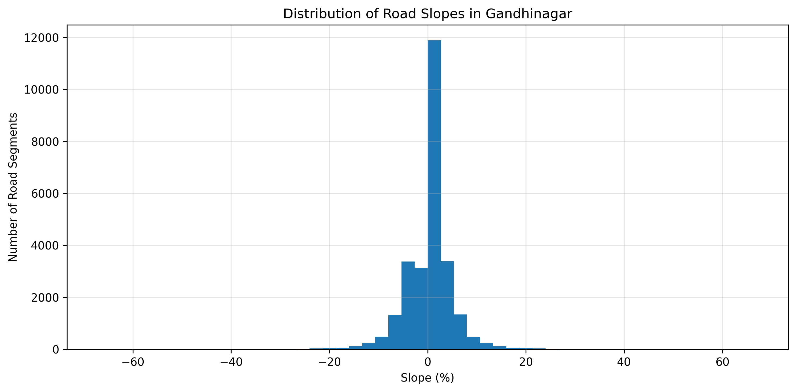
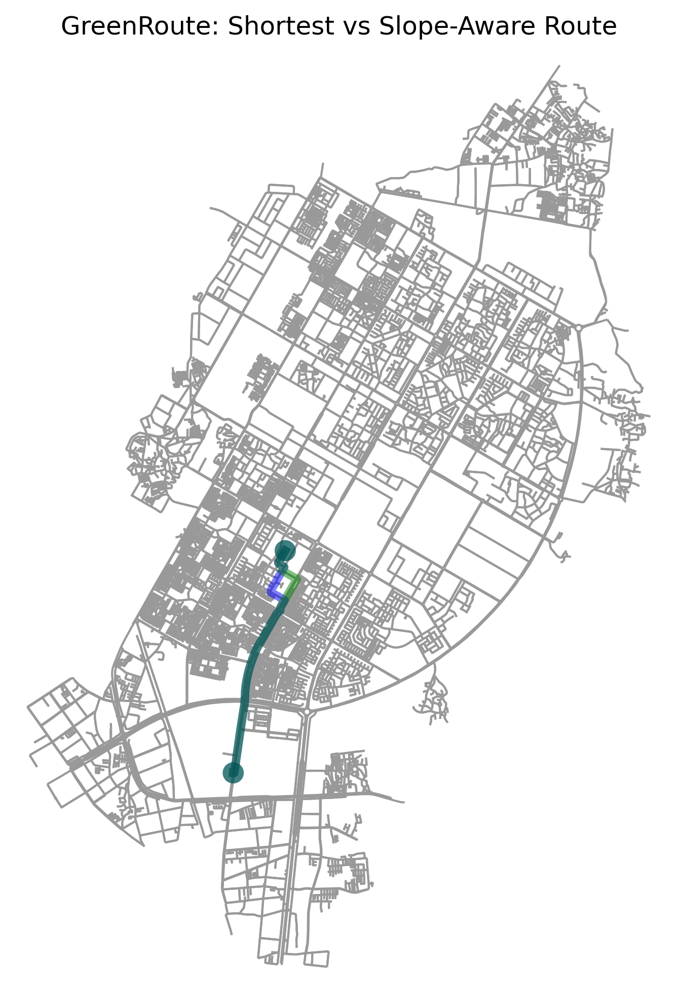

# 🌱 Green Route
### Smarter Routes. Greener Tomorrow.

**An ML-driven approach to sustainable transportation and eco-friendly route optimization.**

Green Route aims to explore how geospatial analysis, elevation data, road network characteristics and vehicle emission estimation can contribute to environmentally conscious route planning.

📍 **Study Area:** Gandhinagar, Gujarat, India

---

## 🚀 Project Overview

Traditional route planning often focuses on distance and travel time. Green Route explores an additional dimension: environmental impact.

The project analyzes road networks, elevation, road slopes and vehicle emission data to establish a foundation for sustainable route optimization.

The long-term goal is to develop a route recommendation system that considers both transportation efficiency and environmental impact.

## ✨ Current Implementation

### 1. Exploratory Data Analysis (EDA)
- Vehicle emission dataset exploration
- Data inspection and statistical analysis
- Distribution analysis and visualizations

### 2. Road Network Analysis
- Road network extraction and exploration
- Road segment and road type analysis
- Road network statistics for Gandhinagar
- Distance and travel-time analysis

### 3. Elevation & Slope Analysis
- Elevation data processing
- Road slope estimation
- Elevation distribution analysis
- Slope distribution visualization

### 4. Route Comparison
- Baseline route comparison
- Distance and travel-time analysis
- Initial CO₂ emission estimation

## 🛠️ Technology Stack

| Category | Technologies |
|---|---|
| Programming | Python |
| Development | Jupyter Notebook |
| Data Analysis | Pandas, NumPy |
| Visualization | Matplotlib |
| Geospatial Analysis | OSMnx, OpenStreetMap |
| Elevation Data | SRTM DEM |
| Version Control | Git, GitHub |

## 📊 Project Visualizations

### Road Network of Gandhinagar


### Elevation Distribution


### Road Slope Distribution


### Route Comparison


## 📁 Repository Structure

```text
Green-Route/
│
├── data/
│   ├── elevation/
│   └── vehicle_emission.csv
│
├── notebook/
│   ├── GreenRoute_EDA.ipynb
│   └── RoadNetwork_EDA.ipynb
│
├── output/
│   ├── elevation_distribution.png
│   ├── elevation_summary.csv
│   ├── gandhinagar_road_map.png
│   ├── road_network_statistics.csv
│   ├── route_comparison.csv
│   ├── route_comparison.png
│   ├── slope_distribution.png
│   └── slope_summary.csv
│
├── .gitignore
└── README.md
```

## 🔬 Project Development Status

| Module | Status |
|---|---|
| Vehicle Emission EDA | Completed |
| Road Network EDA | Completed |
| Elevation Analysis | Completed |
| Slope Analysis | Completed |
| Baseline Route Comparison | Implemented |
| ML-based Emission Prediction | Planned |
| Eco-friendly Route Optimization | Planned |
| Final Route Recommendation System | Planned |

## 🎯 Future Scope

- Develop machine learning models for emission prediction.
- Incorporate road elevation and slope into route optimization.
- Compare shortest, fastest and eco-friendly routes.
- Develop an intelligent sustainable route recommendation system.
- Visualize environmental impact across alternative routes.

## 👩‍💻 Project Information

**Project:** Green Route  
**Domain:** Machine Learning, Data Science & Geospatial Analysis  
**Location:** Gandhinagar, Gujarat, India

---

*Building smarter transportation systems for a greener future. 🌍*
